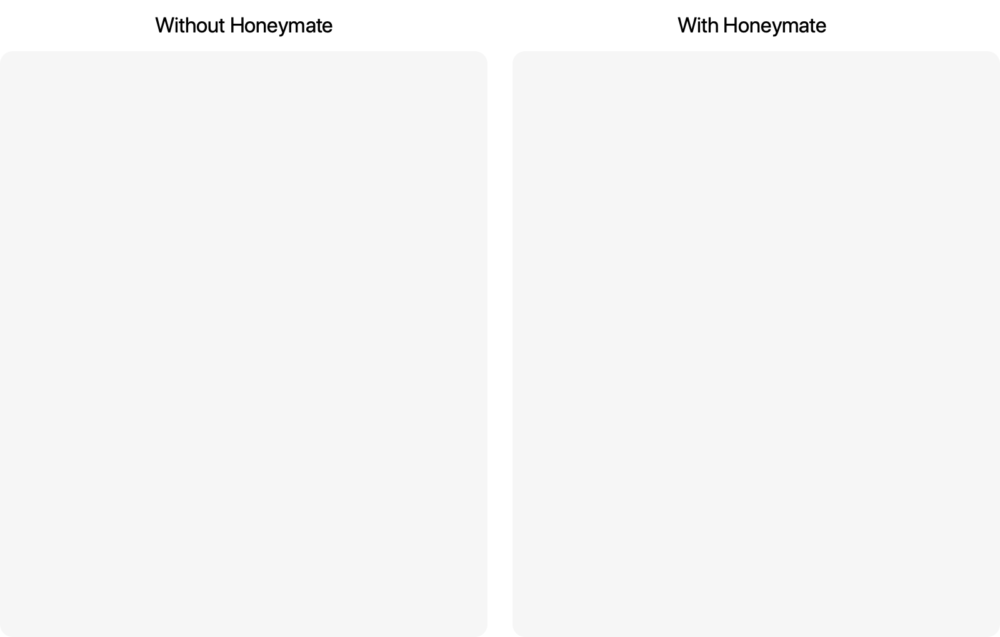

<h1 align="center">
<br>
    
<br>
  Honeymate
<br>
</h1>

<h4 align="center">
    Dead simple loading animations.
</h4>
<p align="center">
    Honeymate waits for images, background images, and videos
    inside blocks, then reveals them with the selected animation.<br>
    Allows you to easily manage the page load order,
    indicating the order in which items are displayed.
<p>

<p align="center">
    <a href="https://www.npmjs.com/package/honeymate">
        
    </a>
</p>



**Simple.** Honeymate has declarative API therefore has a low entry threshold.

**Small.** 2.2 kilobytes (minified and gzipped). No dependencies.

**Fast.** Only CSS animations are used.

## Install

Use npm:

```sh
npm install honeymate --save
```

Or build from source:

```sh
pnpm install
pnpm build
```

## Setup

Link the CSS and the browser bundle:

```html
<link rel="stylesheet" href="node_modules/honeymate/style.css" />
<script src="node_modules/honeymate/dist/honeymate.js"></script>
```

If built from source, use `style.css` and `dist/honeymate.js` from this repository.

Now any element with `class="honey"` fades in after its media is loaded:

```html
<div class="honey">... Show this only when it is ready ...</div>
```

The script initializes automatically when loaded. Any element with `class="honey-replay"`
will replay all `.honey` animations on click.

## Media Loading

Before showing a `.honey` element, Honeymate waits for media in the element itself and
in all descendants:

- `` elements.
- CSS background images declared through `background` or `background-image`.
- `<video>` elements.

Images resolve on both `load` and `error`, so broken images do not block the reveal.

### Video loading control

By default, Honeymate waits for the `canplaythrough` event on each video. Use
`data-event` to choose another video readiness event:

```html
<div class="honey" data-event="loadedmetadata">
  <video src="intro.mp4" muted playsinline></video>
</div>
```

This is useful when you want to reveal a block earlier (`loadedmetadata`, `loadeddata`,
`canplay`) or keep the default stricter wait (`canplaythrough`). Videos that already
have current data, or already have an error when Honeymate checks them, do not block the
reveal.

## Examples

```html
<div class="honey" data-effect="helix" data-hold="400" data-spin="true">
  
</div>
```

```html
<div id="hero" class="honey" data-effect="zoom">Hero</div>
<div class="honey" data-await="hero" data-effect="fade">Shown after hero starts showing</div>
```

## Options

Specify options as `data-*` attributes on `.honey` elements.

- `data-effect` — Current effect. Available effects: `fade` (default), `zoom`, `helix`, `slide`, `relax`, `focus`.
- `data-duration` — Animation duration in milliseconds. Default is `640`.
- `data-hold` — Extra wait before revealing the element, in milliseconds. Default is `50`.
- `data-await` — Wait for the `.honey` element with this ID to start showing.
- `data-continue` — With `true`, wait for the previous `.honey` element in DOM order to start showing.
- `data-expose` — With `true`, wait until the element intersects the viewport. This option uses `IntersectionObserver`.
- `data-event` — Video event to wait for. Default is `canplaythrough`.
- `data-scale` — Initial scale for `zoom`, `helix`, `relax`, and `focus`. Default is `1.22` for `focus` and `0.87` for other effects.
- `data-origin` — Transform origin for `slide` and `relax`. Available values: `top`, `bottom` (default), `left`, `right`.
- `data-strength` — Blur strength in pixels for `focus`. Default is `20`.
- `data-up`, `data-down`, `data-left`, `data-right` — Direction and offset for `slide`, for example `data-left="56px"`. Default is `data-up="32px"`.
- `data-spin` — Show a loading indicator while the element waits. Set it to a non-empty value, for example `true`.
- `data-spin-size` — Indicator diameter in pixels. Default is `24`.
- `data-spin-color` — Indicator color. Default is `#000`.

## Credits

The original idea belongs to Ilya Birman,
who made the [Emerge](https://ilyabirman.ru/projects/emerge/).

## Supported browsers

Honeymate supports the latest versions of Safari, Chrome and Firefox.
`data-expose` requires `IntersectionObserver` support.
